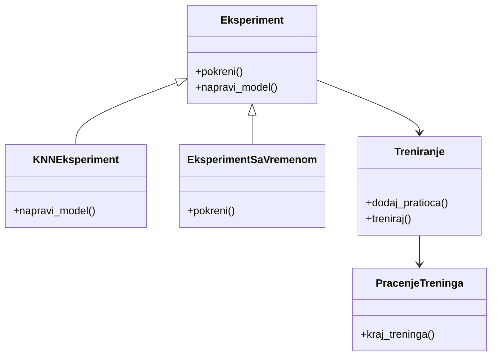

## Opis projekta

U okviru ovog mini projekta napravila sam jednostavan program za rad sa modelima mašinskog učenja, koristeći Iris skup podataka. Cilj zadatka bio je da primijenim projektne šablone koje smo obrađivali na predavanjima i da kroz praktičan primjer vidim kako oni funkcionišu.

Radila sam u Google Colabu, gdje sam postepeno dodavala kod, isprobavala različite modele i provjeravala njihove rezultate. Koristila sam tri modela: logističku regresiju, stablo odlučivanja i kNN.

## Primjena projektnih šablona

U programu sam koristila pet projektnih šablona.

**Factory** sam koristila za kreiranje različitih modela na osnovu njihovog naziva, tako da nije potrebno posebno pisati kod za svaki model.

**Strategy** omogućava izbor metrike za provjeru uspješnosti modela. Koristila sam Accuracy i F1 metrike.

**Observer** sam koristila za praćenje treniranja. Kada model završi treniranje, program ispisuje obavještenje.

**Template Method** određuje redosljed koraka eksperimenta, od pripreme podataka do treniranja i provjere rezultata. Na taj način sam mogla da koristim isti postupak za različite modele.

**Decorator** sam koristila za mjerenje vremena izvršavanja eksperimenta, bez potrebe da mijenjam osnovni postupak.

## Testiranje modela i rezultati

Iris skup podataka sadrži 150 primjera, koje sam podijelila na podatke za treniranje i testiranje. Za treniranje sam koristila 80%, a za testiranje preostalih 20%.

Nakon treniranja provjerila sam uspješnost sva tri modela pomoću Accuracy i F1 metrika. Najbolje rezultate na ovom testnom skupu imao je kNN model, zatim logistička regresija, dok je stablo odlučivanja imalo nešto slabiji rezultat.

Radi lakšeg poređenja, rezultate sam prikazala tabelom i grafikonom u Google Colabu.

## Pytest testovi

Za provjeru programa napisala sam šest pytest testova. Testirala sam kreiranje modela, ponašanje programa kada se unese nepoznat model, računanje tačnosti, dodavanje pratioca, pokretanje eksperimenta i rad dekoratora.
Prilikom prvog pokretanja testova pojavile su se greške jer pytest nije mogao da pronađe funkcije koje su bile definisane u Colabu. Problem sam riješila tako što sam glavni kod sačuvala u fajl 'projekat.py', a testove povezala sa tim fajlom.
Nakon ispravke ponovo sam pokrenula pytest i svih šest testova je uspješno prošlo.

Za pokretanje testova koristi se komanda:

`python -m pytest test_projekat.py -v`

## Korišćenje AI alata

Tokom izrade projekta koristila sam ChatGPT kao pomoć pri razumijevanju projektnih šablona i njihovoj primjeni u Pythonu. Posebno mi je koristio prilikom povezivanja različitih djelova programa i rješavanja problema sa testiranjem.
Neki od upita koje sam koristila odnosili su se na to kako napraviti jednostavan Factory za ML modele, kako primijeniti Strategy za izbor metrike, kako povezati Observer sa treniranjem i kako pokrenuti pytest testove u Google Colabu.
Prijedloge sam postepeno isprobavala i prilagođavala kod kako bi ostao što jednostavniji. Najvažnija ispravka bila je izdvajanje koda u poseban Python fajl, jer početni način pokretanja testova nije funkcionisao.

## Dijagram klasa

Mermaid dijagram prikazuje glavne klase korišćene u projektu, njihove metode i međusobne veze.

## Zaključak

Kroz ovaj projekat sam bolje razumjela kako se projektni šabloni mogu koristiti u jednom praktičnom primjeru. Takođe sam vježbala rad sa modelima mašinskog učenja, poređenje njihovih rezultata i pisanje testova.

Najviše pažnje posvetila sam tome da različiti djelovi programa budu povezani i da mogu pravilno da se testiraju.

