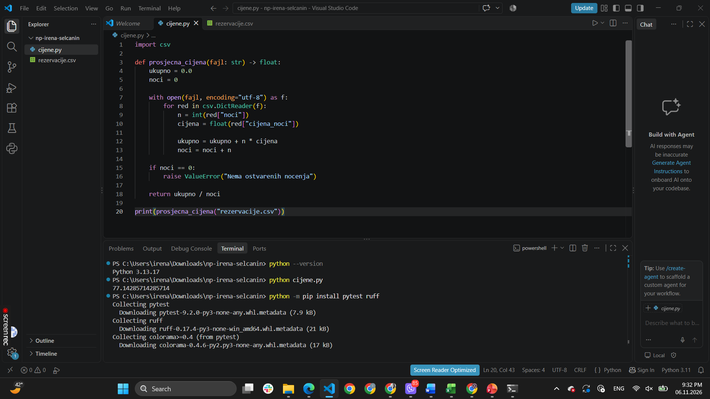
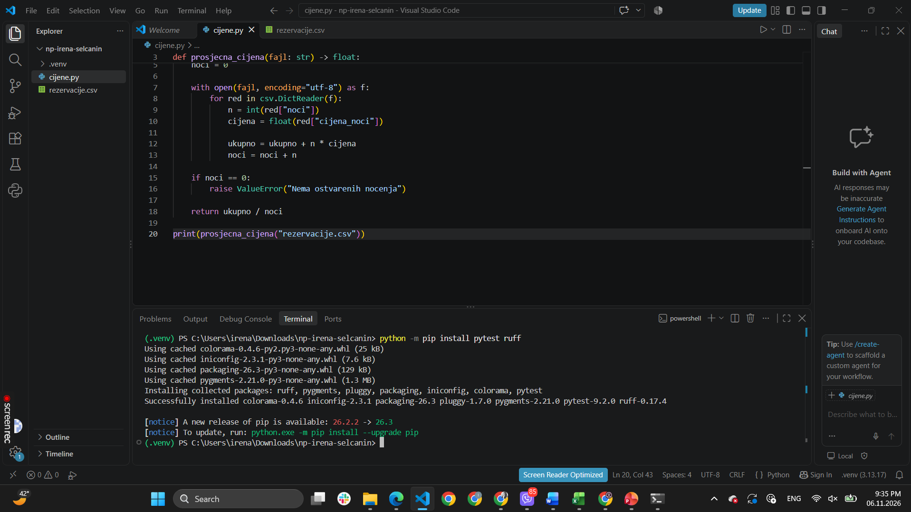
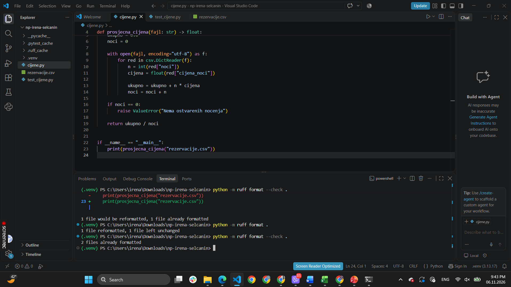

# Napredno programiranje – Nedjelja 1

## Opis zadatka
U ovom zadatku napravila sam jednostavan Python program koji računa prosječnu cijenu noćenja na osnovu podataka iz CSV fajla.
U fajlu 'rezervacije.csv' nalaze se imena gostiju, broj noćenja i cijena po noći. Program učitava te podatke, računa ukupan iznos i dijeli ga sa ukupnim brojem noćenja.
Dodala sam i primjer gosta sa 0 noćenja kako bih provjerila da li program i dalje pravilno računa prosjek.

## Alati koje sam koristila
- Python 3.13.17 i VS Code
- pytest za testiranje
- Ruff za provjeru i formatiranje koda
- ChatGPT kao pomoć pri izradi i razumijevanju zadatka

## Korišćenje AI alata
Koristila sam ChatGPT da mi pomogne pri pisanju jednostavne funkcije za računanje prosječne cijene noćenja iz CSV fajla.
Tražila sam da kod bude što jednostavniji za razumijevanje, ali da zadrži with open(), type hints i provjeru slučaja kada nema noćenja, kao što smo radili na predavanju. („Može li bez Path i postoji li jednostavniji način?“)
Pored toga, koristila sam AI za objašnjenje pojedinih djelova koda i pomoć pri pisanju testova.

## Šta sam primijetila
Prilikom rada na zadatku odlučila sam se za jednostavniji način čitanja CSV fajla pomoću 'with open()'.
Dodala sam provjeru da li je ukupan broj noćenja jednak nuli, kako program ne bi pokušao da dijeli nulom.
Takođe sam primijetila da bi program mogao dodatno da se poboljša, na primjer da ispiše jasniju poruku ako su podaci u CSV fajlu pogrešno uneseni.

## Testiranje

Napravila sam dva testa pomoću pytest-a. Prvi provjerava da li program pravilno računa prosjek, a drugi provjerava slučaj kada nema noćenja. Oba testa su prošla uspješno. Nakon toga sam koristila Ruff za formatiranje koda.

## Rezultati

### Pokretanje programa

Program je uspješno pokrenut i dobijena je prosječna cijena noćenja od približno 77.14 €

### Testiranje pomocu pytest-a

Na slici se vidi da su oba testa uspješno prošla.

### Provjera formatiranja pomocu Ruff-a

Nakon formatiranja i ispravljanja pronađenih problema, Ruff više nije prijavljivao greške

## Pokretanje programa

Program se pokreće komandom:

'python cijene.py'

Testovi se pokreću komandom:

'python -m pytest -q'
